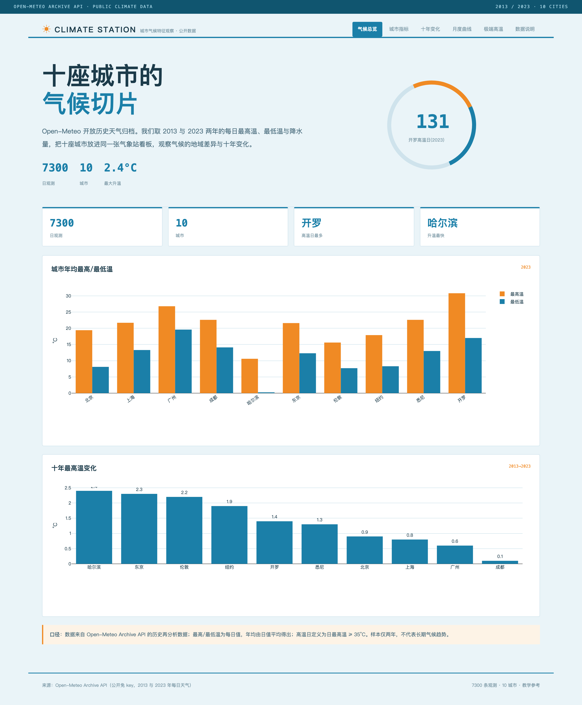
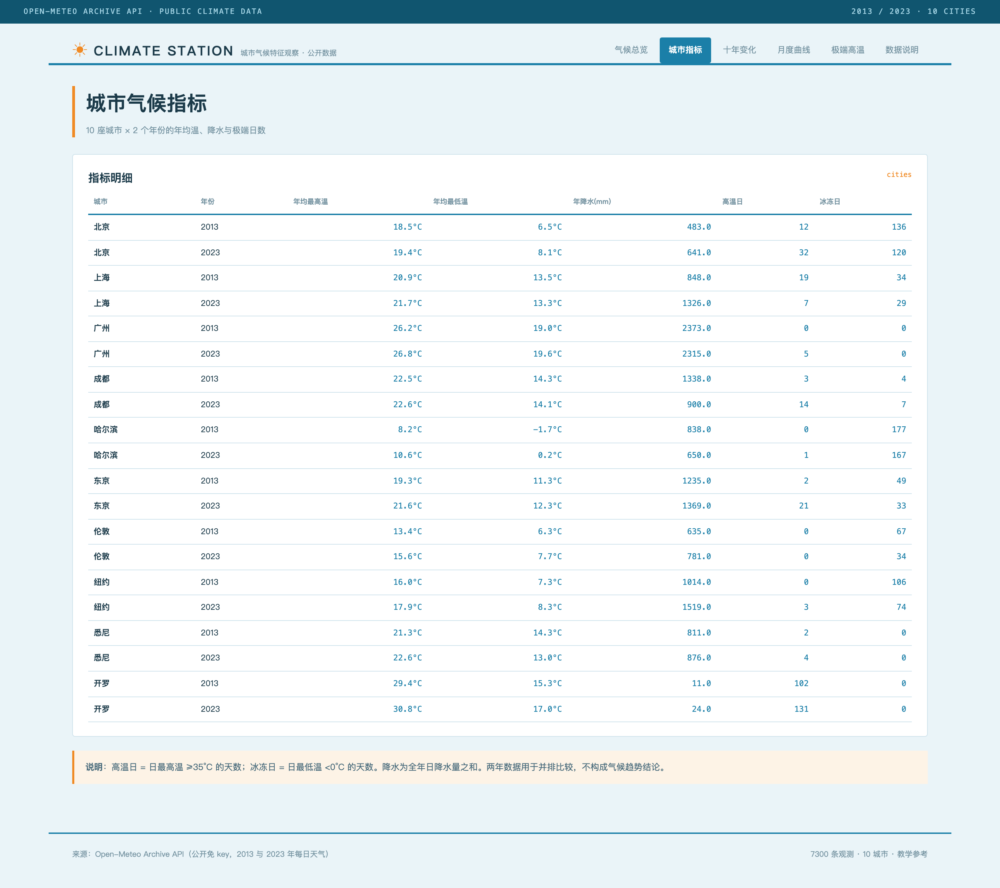
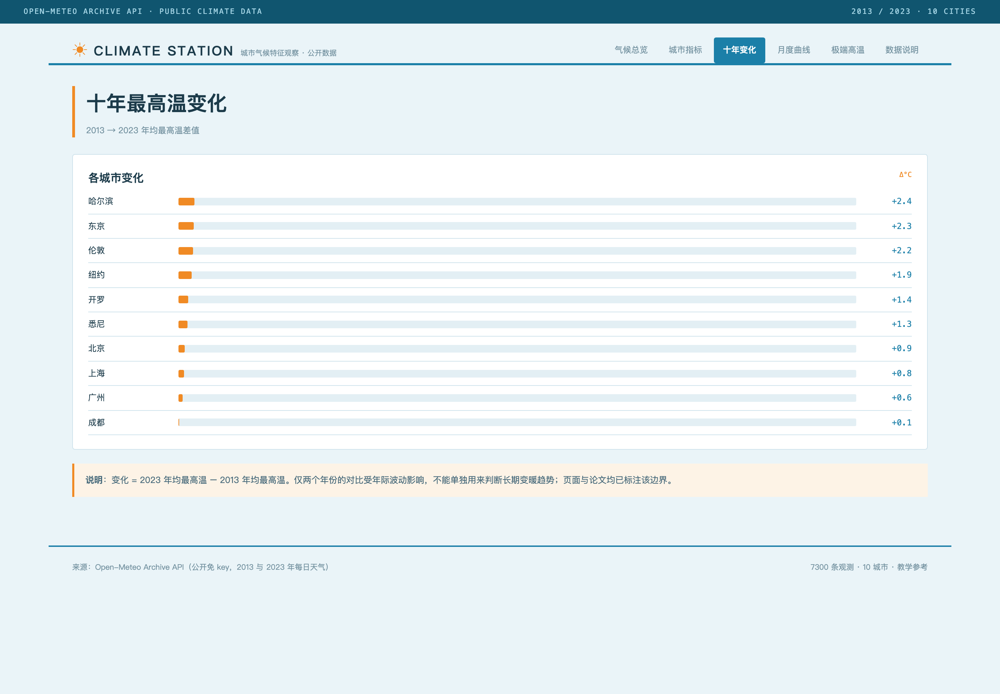
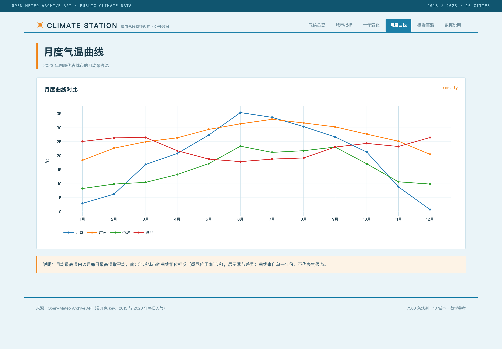
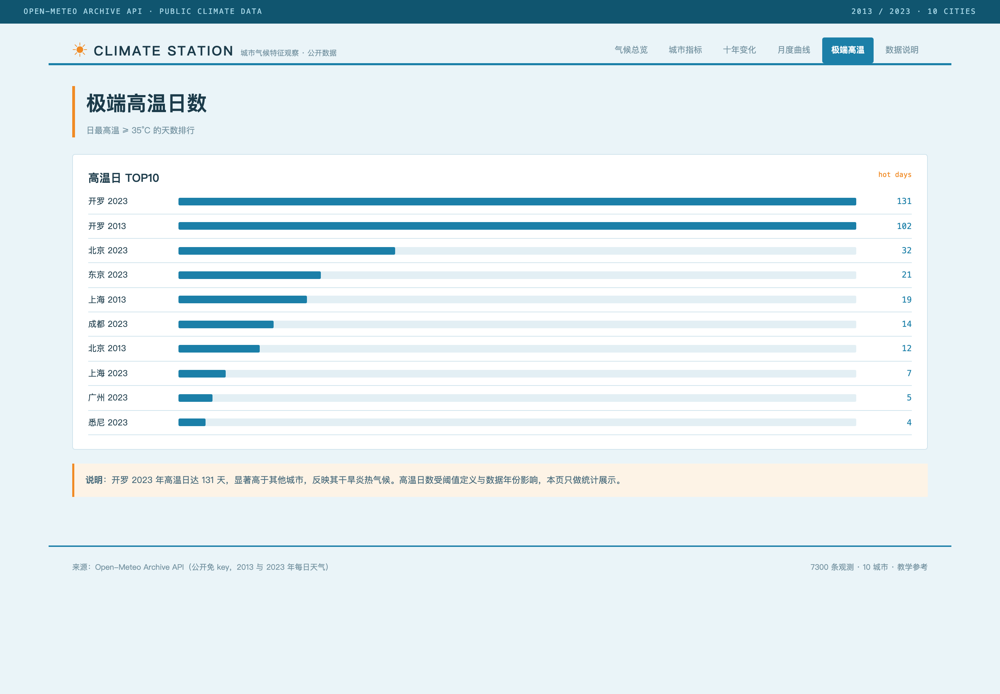
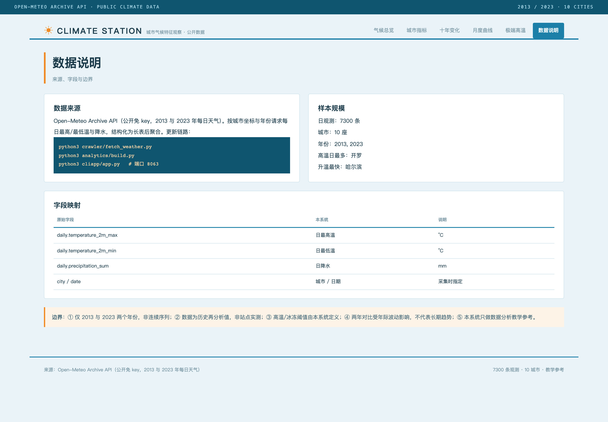

# 063 基于Open-Meteo公开数据的城市气候特征分析系统-设计展示

> **代码有偿获取 可接受定制 微信联系方式: csbysj2020 或 ACE2487，备注(BS)**

> **完整源码与全套文档 · 在线自助获取 >>> [https://mbd.pub/o/bread/YZaWmJprZQ==](https://mbd.pub/o/bread/YZaWmJprZQ==)**

> **成品页（功能介绍 / 更多选题）>>> [https://bishe.suilang.net/products/climate-station](https://bishe.suilang.net/products/climate-station)**

> 

> 

## 视频

> **点击查看 >>> [https://www.bilibili.com/video/BV1xTytz7ENb/](https://www.bilibili.com/video/BV1xTytz7ENb/)**

## 项目简介

气象站风格（浅天蓝、暖橙、圆形仪表意象），区别于行政图集/账册/海报/画廊/控制台/田野指南。采集 Open-Meteo 公开天气数据 7300 条日观测、10 座城市（2013 与 2023），从城市均温、十年变化、月度曲线与极端高温四维分析。Flask + Plotly.js（本地化离线可用），6 个页面。再分析数据性质与两年对比边界如实标注，不构成气候趋势结论。

城市气候特征是理解地域差异的基础。

本项目设计并实现了一套基于 Open-Meteo 公开数据的城市气候特征分析系统：通过 Archive API 按城市坐标与年份取 2013 与 2023 两年每日天气，结构化后入库 7300 条日观测（覆盖 10 座城市），从城市均温、十年变化、月度曲线与极端高温日四个维度聚合分析。

系统采用 Flask + Plotly.js 与气象站式界面（浅天蓝、暖橙、圆形仪表意象），实现气候总览、城市指标、十年变化、月度曲线、极端高温、数据说明 6 个页面。

本仓库为**设计展示**：包含项目说明、技术架构、实验结果与运行截图；完整源码、任务书、开题报告、毕业论文与使用说明可通过上方链接自助获取，成品页可查看更多选题，也可联系微信咨询定制。

## 功能特性

1. 差异化视觉：气象站（浅天蓝/暖橙/圆形仪表），非看板/图集/账册/海报/画廊

2. 真实采集：Open-Meteo Archive API 公开免 key，7300 条日观测、10 城市

3. 四维分析：城市均温/十年变化/月度曲线/极端高温

4. 极端高温：开罗 2023 年高温日达 131 天

5. 十年变化：哈尔滨均最高温上升 2.4°C 居首

6. 技术栈差异化：Flask + Plotly.js（本地化）

7. 合规边界：再分析数据与两年对比边界如实标注，不构成气候趋势结论

## 技术架构

| 项目 | 说明 |
| --- | --- |
| 编程语言 | Python 3.8+ |
| Web 框架 | Flask（轻量路由，无 ORM） |
| 图表 | Plotly.js（本地化离线可用） |
| 数据源 | Open-Meteo Archive API（公开免 key） |
| 样本规模 | 7300 观测 / 10 城市 |
| 运行端口 | http://127.0.0.1:8063 |
| 说明 | 数据直读 analysis JSON，无需数据库 |

## 目录结构

以下为完整交付版的结构（本仓库仅作设计展示）：

```
climate-station/
├── analytics/
│   └── build.py
├── cliapp/
│   └── app.py
├── crawler/
│   └── fetch_weather.py
├── data/
│   ├── analysis/
│   │   ├── changes.json
│   │   ├── cities.json
│   │   ├── hot_days.json
│   │   └── monthly.json
│   ├── processed/
│   │   └── weather.csv
│   └── stats.json
├── static/
│   ├── css/
│   │   └── style.css
│   └── vendor/
│       └── plotly.min.js
├── templates/
│   ├── about.html
│   ├── base.html
│   ├── change.html
│   ├── cities.html
│   ├── extreme.html
│   ├── monthly.html
│   └── overview.html
├── 任务书/
│   └── 毕业设计任务书.docx
├── 开题报告/
│   └── 毕业设计开题报告.docx
├── 最终论文/
│   ├── 图/
│   │   └── fig-arch.png
│   └── 基于Open-Meteo公开数据的城市气候特征分析系统设计与实现.docx
├── 演示截图/
│   ├── 063-01-overview.png
│   ├── 063-02-cities.png
│   ├── 063-02-regions.png
│   ├── 063-03-change.png
│   ├── 063-03-changes.png
│   └── …
└── …
```

## 数据与实验结论

- 实验显示开罗 2023 年高温日达 131 天，哈尔滨十年均最高温上升 2.4°C。
- 真实采集：Open-Meteo Archive API 公开免 key，7300 条日观测、10 城市
- 极端高温：开罗 2023 年高温日达 131 天
- 十年变化：哈尔滨均最高温上升 2.4°C 居首

## 交付内容

1. 完整源码（Flask 应用 + 采集器 + 分析引擎 + 6 页面）
2. 真实数据（weather.csv + analysis JSON）
3. 任务书与开题报告（Word）
4. 毕业论文（Word 七章制）
5. 二次开发说明（Word+md）
6. 6 张截图 + 封面 + 演示视频

## 常见问题

**是长期趋势吗？**

不是，只有 2013 与 2023 两年，受年际波动影响，页面与论文均说明。

**数据是实测吗？**

是历史再分析值，非站点实测。

**高温日怎么定义？**

日最高温 ≥35°C 计为一个高温日，阈值由本系统定义。

**图表能离线用吗？**

能，plotly.min.js 已本地化到 static/vendor/。

## 截图







